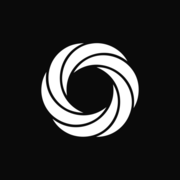

<div align="center">
  

  <h1 align="center">RDK Site</h1>

[Website](https://rdk.omni.dev) | [Docs](https://docs.omni.dev/products/rdk) | [Discord](https://discord.gg/omnidotdev) | [X](https://x.com/omnidotdev) | [Threads](https://www.threads.com/@omnidotdev)

</div>

Marketing site for [RDK](https://github.com/omnidotdev/rdk), the React-first framework for building web-based XR experiences, from AR to VR, through one unified API powered by Three.js and react-three-fiber. Live at [rdk.omni.dev](https://rdk.omni.dev).

## Development

```bash
bun install
bun dev
```

## License

The code in this repository is licensed under Apache 2.0, &copy; [Omni LLC](https://omni.dev). See [LICENSE.md](LICENSE.md) for more information.
